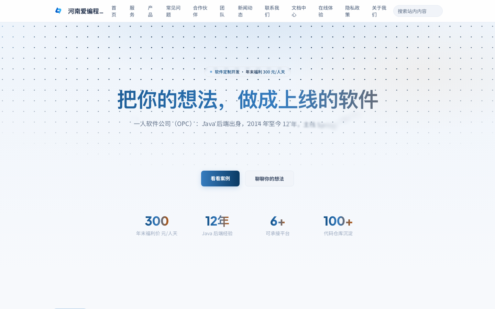
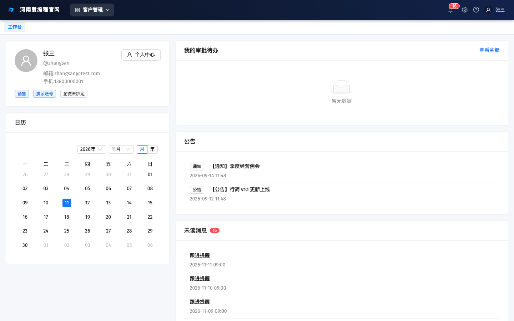
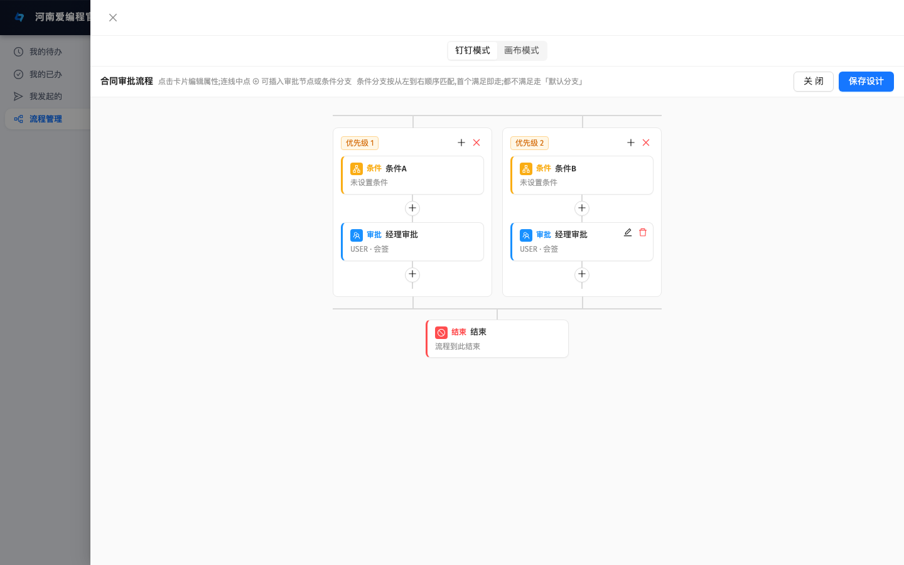
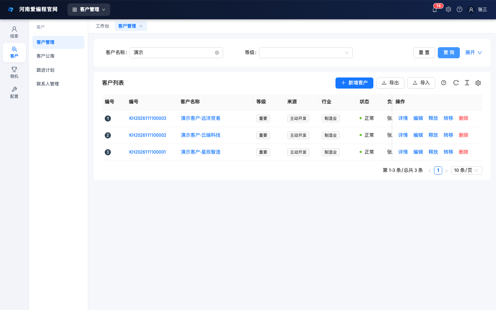
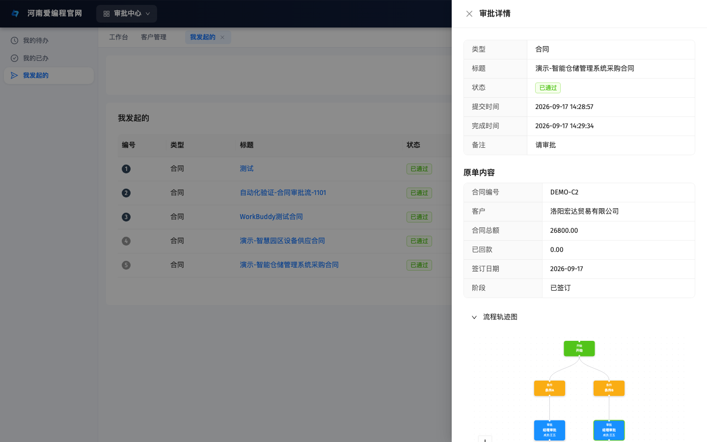
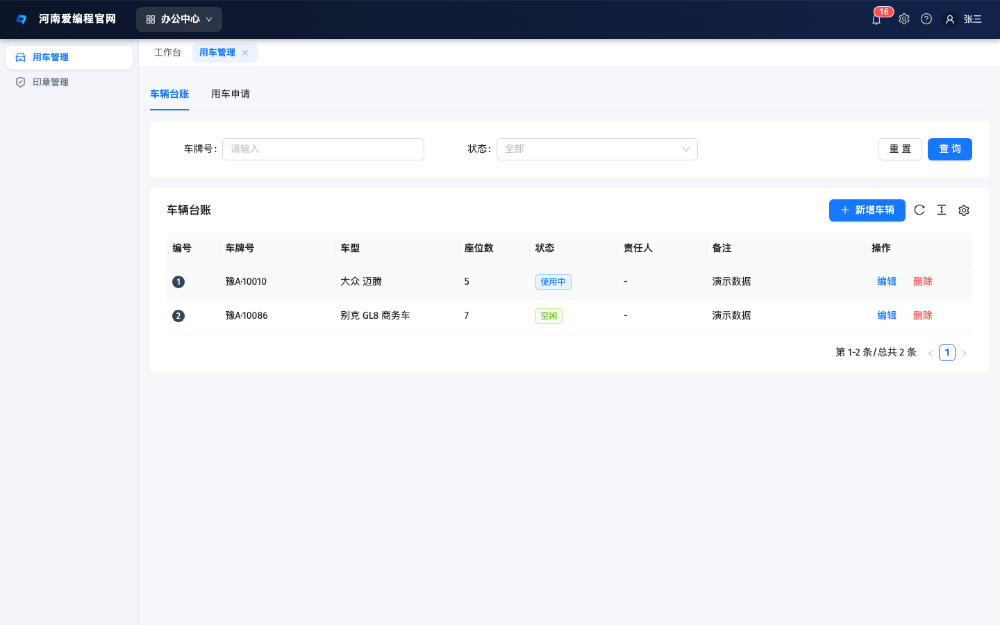
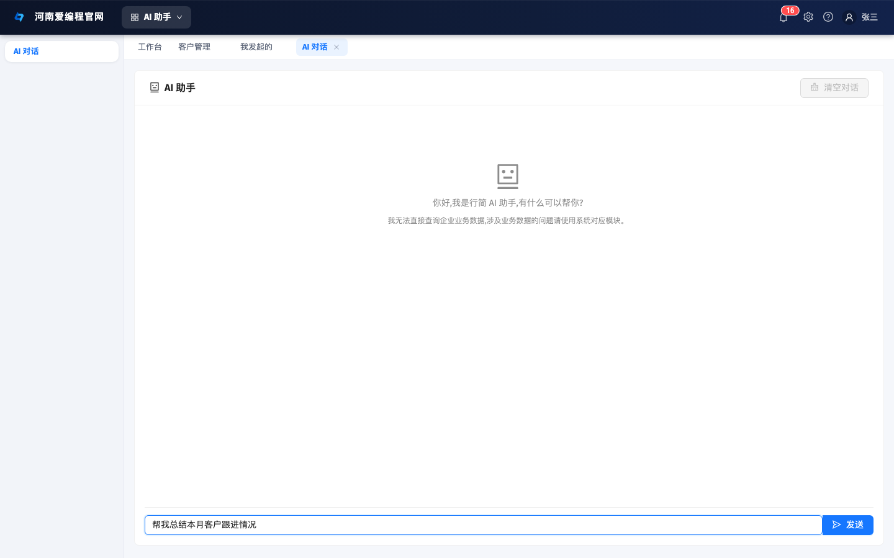
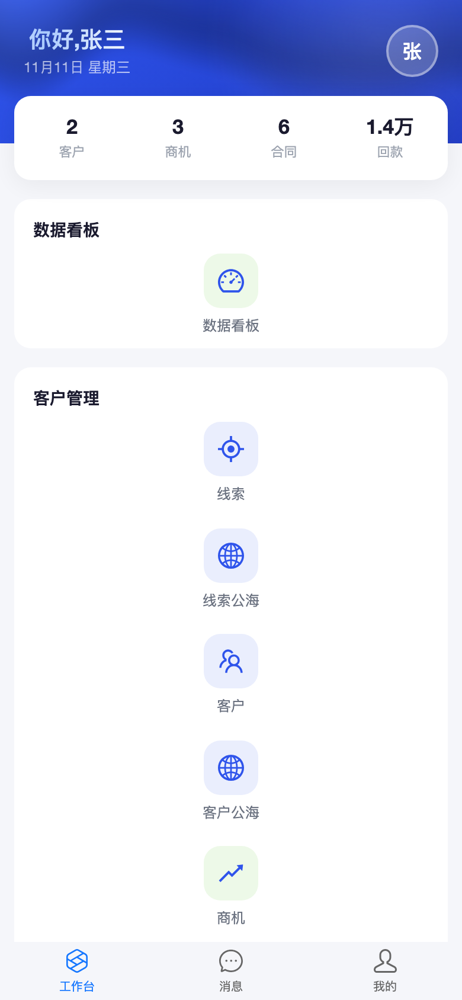
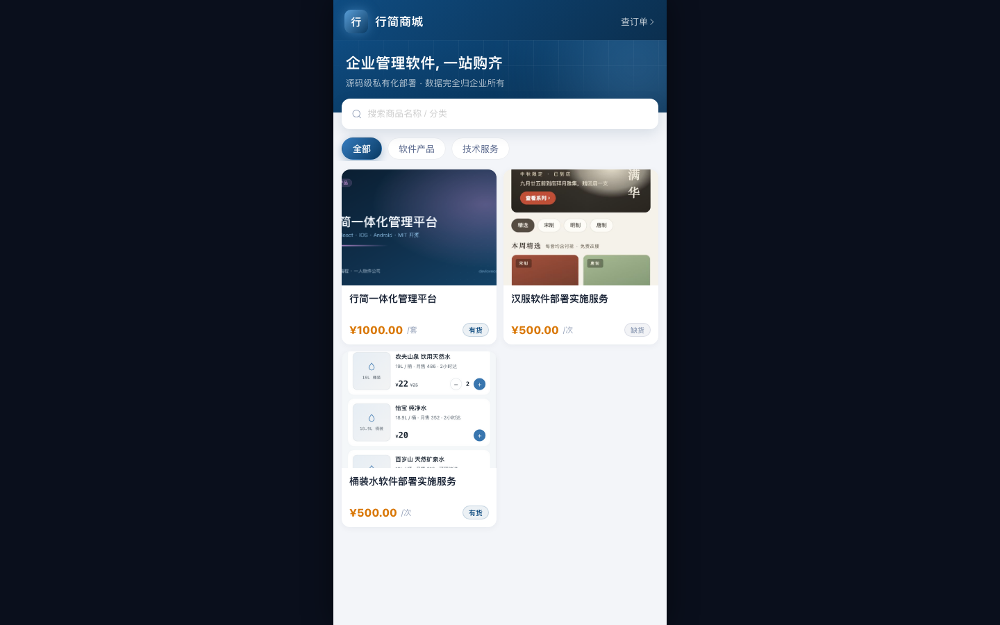

# 行简 XingJian

<p align="center">
  
</p>


> **行简**——面向中小企业的开源一体化业务管理平台：**CRM 客户管理 / OA 协同办公 / BPM 审批流 / HRM 人力资源 / ERP 进销存 / 财务管理 / 项目管理 / 商城 / 官网 CMS**，一套系统管好整个企业。
>
> **Go 单体架构**：2核4G 云服务器跑完全栈还有富余；内置 **MCP Server（86+ 工具）**，AI 助手（ZCode/Claude 等 MCP 客户端）可直接操作整个系统——「AI 业务系统」而不只是「带 AI 功能的管理软件」。

---

## ✨ 为什么选择行简

| | |
| --- | --- |
| 🏢 **一体化**：CRM/OA/HRM/ERP/财务全部打通，一个平台管好整个企业 | 💰 **低成本**：Go 单体二进制 + MySQL + Redis，2核4G 单机全栈，部署当天可用 |
| 🔄 **审批驱动**：自研 BPM 引擎（转办/委托/加签/版本快照/轨迹图）+ 钉钉式可视化设计器 | 🤖 **AI 可直接操作**：内置 MCP Server（86+ 工具），任何 MCP 客户端可直接查客户/建合同/审单据 |
| 📱 **全端覆盖**：后台 + H5 + iOS + Android + 桌面端，一套后端全适配 | 🔓 **真开源**：MIT 协议 100% 免费商用，代码完全开放 |

## 🌐 在线体验

| 入口 | 地址 | 账号 |
| --- | --- | --- |
| 🖥️ **管理后台演示(超管全功能)** | [admin.devlovecode.com](https://admin.devlovecode.com) | `admin / 123456`（公开演示超管，每周一 03:00 自动重置） |
| 🖥️ **演示账号(仅本人数据)** | [admin.devlovecode.com](https://admin.devlovecode.com) | `zhangsan / 123456`（演示集，数据权限=仅本人） |
| 📱 **移动端 H5** | [m.devlovecode.com](https://m.devlovecode.com) | `zhangsan / 123456` |
| 🛒 **公开商城** | [mall.devlovecode.com](https://mall.devlovecode.com) | 免登录 |
| 🏠 **官网** | [devlovecode.com](https://devlovecode.com) | — |

> 💡 **公开演示说明**：`admin / 123456` 为超管全功能公开试用（可体验全部 20 个模块；系统配置/重置/API Key 已冻结防误操作；演示数据每周一 03:00 自动重置回演示集，请勿存放真实数据）。`zhangsan / 123456` 为仅本人数据权限的演示账号。建议 Chrome/Edge 浏览器体验。

## 📦 功能模块总览

> 🔥 一个平台覆盖企业全链路业务，模块化架构、按需启用

| 子系统 | 核心功能 |
| --- | --- |
| 🤝 **CRM 客户管理** | 线索/公海/客户/联系人/商机/合同（变更留痕/归档/到期提醒）/回款/查重/产品分类树/售后工单/天眼查工商信息查询，跟进记录时间线 |
| 🏠 **OA 协同办公** | 报销/出差/借款/用车/印章/会议室预约/日程/公告/站内信/自定义表单/企业云盘（在线分享与免登领取） |
| ⚙️ **BPM 审批流** | 自研引擎：钉钉式可视化设计器 + 画布模式双模、会签/或签/依次、转办/委托/加减签、退回重审、超时审批、版本快照、流程轨迹图 |
| ⚡ **自动化工作流** | n8n 式可视化画布编排业务，手动/定时/事件三种触发，LLM 步骤可调用大模型，节点执行轨迹全程可查 |
| 👥 **HRM 人力资源** | 员工档案/部门岗位/考勤打卡（企微同步）/排班 v2/假期额度/薪酬（社保方案+公式引擎）/绩效/招聘 |
| 📊 **ERP 进销存** | 采购/销售/库存多仓/商品 SKU 多规格/盘点/调拨，单据全自动过审批 |
| 💰 **财务管理** | 会计科目/凭证/账簿/利润表/资产负债表/发票台账/应收应付往来款 |
| 🛒 **企业商城** | 独立公开商城站，商品复用 CRM 产品库，下单自动生成销售单 |
| 🌐 **官网 CMS** | 文章定时发布/有效期、修订版本回滚、站内搜索、产品分类树筛选、FAQ/JSON-LD GEO 优化、跨境独立站双主题 |
| 📋 **项目管理** | 项目/任务/看板/优先级 |
| 📚 **知识库** | 文档协同编辑、历史版本、RAG 召回（Embedding 向量检索） |
| 📡 **营销中心** | 抖音/巨量线索自动入库 CRM、GEO（AI 引擎优化）内容产线 |
| 📈 **数据看板** | 工作台 BI 汇总、CRM/HRM/财务/进销存分析看板 |
| 🤖 **AI 能力** | **MCP Server（340+ 工具，AI 直接操作系统）**、LLM 网关（多模型控制台热切换）、AI 对话（知识库 RAG 召回）、AI 场景（经营洞察/审批助手/日报生成）、发票 OCR 识别、AI 质检 |
| 🔧 **基础设施** | RBAC 数据权限/多租户式组织树/自动编号/操作日志/IP 归属地/SSE 实时通知/企微集成/文件存储可配置（本地/OSS/S3 兼容热切换） |

## 🏗️ 技术架构

```
浏览器 / 手机 / 桌面 / AI(MCP)
        │  /prod-api（统一前缀）
        ▼
┌─────────────────────────────────────────────────┐
│                 qzt-go-server（唯一数据源）        │
│  Gin + GORM + Casbin(RBAC/数据权限) + Redis       │
│  ┌──────┬──────┬──────┬──────┬──────┬──────┐    │
│  │ CRM  │  OA  │ HRM  │ ERP  │ 财务 │ 商城  │... │
│  └──────┴──────┴──────┴──────┴──────┴──────┘    │
│        MCP Server │ LLM 网关 │ SSE │ 定时任务     │
└────────────────────┬────────────────────────────┘
                     ▼
            MySQL（唯一存储）+ 阿里云 OSS（文件）
```

**部署形态**：单个 Go 二进制 + MySQL + Redis，单机 2核4G 即可全栈运行（生产实测整机内存 4G 用 970Mi）。对比同类 Java 微服务一体化平台（Gateway + Nacos + RocketMQ 起步 16G 内存），**运维成本降低一个量级**。

### 核心技术选型

| 层级 | 选型 | 版本 |
| --- | --- | --- |
| 后端 | Go + Gin + GORM + Casbin | Go 1.25 |
| 缓存/会话 | Redis | 6.x |
| 前端（后台） | React + antd 5 / ProComponents + Zustand + Vite | React 19 |
| 前端（官网） | Next.js 15 (App Router) + Tailwind | 15 |
| 移动端 | antd-mobile H5 + SwiftUI(iOS) + Compose(Android) | — |
| 桌面端 | Tauri 2 (Rust) | 2.x |
| AI | MCP (Streamable HTTP) + OpenAI 兼容 LLM 网关 | — |
| 部署 | systemd + nginx + rsync（或 Docker 自行编排） | — |

## 📸 系统截图

<table>
  <tr>
    <td></td>
    <td></td>
  </tr>
  <tr>
    <td align="center">工作台（日历/审批待办/公告）</td>
    <td align="center">BPM 流程设计器（钉钉式/画布双模）</td>
  </tr>
  <tr>
    <td></td>
    <td></td>
  </tr>
  <tr>
    <td align="center">CRM 客户管理（线索→回款全链路）</td>
    <td align="center">审批详情：原单摘要 + 流程轨迹图</td>
  </tr>
  <tr>
    <td></td>
    <td></td>
  </tr>
  <tr>
    <td align="center">OA 用车管理（台账 + 用车申请 + 审批联动）</td>
    <td align="center">AI 助手（LLM 网关，MCP 是更大的一张牌）</td>
  </tr>
</table>

<table>
  <tr>
    <td></td>
    <td></td>
    <td></td>
  </tr>
  <tr>
    <td align="center">移动端 H5</td>
    <td align="center">企业商城</td>
    <td align="center">官网</td>
  </tr>
</table>

## 🎯 适用场景

10 ~ 500 人的中小企业：制造业 / 贸易 / 互联网 / 建筑工程 / 物流 / 教育培训 / 医疗健康 / 零售连锁 / 服务业。一套系统替代「OA + HRM + CRM + ERP 各买一套」的割裂采购。

## 🚀 快速开始

```bash
# 1. 启动后端（qzt-go-server/，依赖 .env 与 config/config.dev.yaml，建表/种子走 docs/sql/）
cd qzt-go-server && make run

# 2. 启动任意前端（各开一个终端）
cd qzt-go-admin  && pnpm install && pnpm dev   # :5173
cd qzt-go-mobile && pnpm install && pnpm dev   # :5174
cd qzt-go-mall   && pnpm install && pnpm dev   # :5175
cd qzt-go-cms    && npm install && npm run dev # :3000
```

后端端口固定 **9000**。种子默认管理员 `admin / 123456`（公开演示口径，首登后请立即修改）。环境要求：Go 1.25 / Node 18+ / pnpm / MySQL 8 / Redis 6。

完整工作区指南见 [AGENTS.md](AGENTS.md)；生产部署流程（编译 / rsync / systemd / pm2 / nginx）也以 AGENTS.md 为准。

## 📁 子项目

| 子项目 | 角色 | 技术栈 |
| --- | --- | --- |
| `qzt-go-server/` | 后端 API（全平台唯一数据源） | Go 1.25 + Gin + GORM + Casbin + Redis |
| `qzt-go-admin/` | 后台管理 SPA | Vite 7 + React 19 + antd 5 / ProComponents + Zustand |
| `qzt-go-cms/` | 企业官网（公开站） | Next.js 15 + React 19 + Tailwind 3 |
| `qzt-go-mobile/` | 移动端 H5（员工端） | Vite 7 + React 19 + antd-mobile + Zustand |
| `qzt-go-mall/` | 独立公开商城站（免登录） | Vite 7 + React 19 + antd-mobile + Zustand |
| `qzt-ios/` | iOS 原生 App | SwiftUI + @Observable，iOS 17+ |
| `qzt-android/` | Android 原生 App | Kotlin 2.0 + Compose + Navigation |
| `qzt-desktop/` | 桌面端（Tauri 2 壳） | Tauri 2 + React 19 |
| `qzt-docs/` | 文档站 | Docusaurus 3 + MDX |

## 🔑 关键约定（开发者速览）

- **建表与种子数据一律走 SQL**（`qzt-go-server/docs/sql/`），Go 代码不 AutoMigrate、不写种子。
- **前端 API 统一 `/prod-api` 单前缀**：请求层 baseURL 带 `/prod-api`，Vite proxy 转发到 `localhost:9000` 并 rewrite 掉前缀。
- **后端模块 URL 前缀由模块 `Name()` 决定**：在 `cmd/server/main.go` 注册 `server.Module` 即自动挂 `/<name>`。
- **admin 路由由后端菜单树驱动**：页面文件路径必须与 `sys_menu.component` 对应。
- **私有化部署约束**：任何域名 / 地址不写死在代码里，一律走配置（`sys_site_config` / `.env` / 服务器地址可配置）。
- 敏感配置只放 gitignored 的 `.env`，不入库。

## 🏷️ 版本与发布

全平台统一**三段式语义化版本** `MAJOR.MINOR.PATCH`，当前主线 **v1.1.x**（2026-08-27 首次定版 v1.0.0）。

- **主版本 +1**：破坏性变更；**次版本 +1**：每次对外发布新功能（即一次部署）；**修订号 +1**：纯缺陷修复。
- 发版流程、版本注入机制、运行版本查看方式见 [AGENTS.md](AGENTS.md)。

## 💼 联系我们

> 🔥 想要快速上手？想要代部署？想要定制开发？欢迎随时联系我们！

### 🤝 合作方式

| 服务类型 | 说明 | 费用 |
| --- | --- | --- |
| 🆓 **开源使用** | MIT 协议，自己部署 / 使用 / 修改，随意 | **免费** |
| 🚀 **官方部署服务** | 由我们代为部署上线（服务器自备） | **1000 元 / 次** |
| 🎨 **定制开发** | 按需求定制功能模块，快速交付 | **300 元 / 人天** |
| 🏢 **企业级服务** | 培训 / 运维 / 长期技术支持 | 面谈 |

### 📱 联系方式

<table>
  <tr>
    <td align="center"></td>
    <td align="center"></td>
  </tr>
  <tr>
    <td align="center"><b>微信扫码加我</b><br>史晨阳 · 河南爱编程</td>
    <td align="center"><b>扫码加入技术交流群</b><br>（微信群二维码会过期，失效请从官网获取最新入群方式）</td>
  </tr>
</table>

商务合作也可通过 [官网联系表单](https://devlovecode.com/contact) 留言，会自动进入我们的 CRM 线索池。

### 🛒 获取方式

| | |
| --- | --- |
| Step 1️⃣ | **在线体验**：打开[演示后台](https://admin.devlovecode.com)（admin / 123456 超管全功能，或 zhangsan / 123456 仅本人数据），或看上面的系统截图 |
| Step 2️⃣ | **加入交流群**或添加微信，备注「行简」 |
| Step 3️⃣ | **部署上线**：自己免费部署（MIT），或由我们代部署（1000 元/次，当天可用） |

## 📄 开源协议

**© 2026 河南爱编程网络科技有限公司** · 本项目以 [MIT 协议](LICENSE) 开源，个人与企业可 100% 免费使用。
