# 行简官网（CMS）用户操作手册

> 适用对象：维护官网内容的管理员/运营人员。
> 手册回答一个问题：**后台每个菜单、每个字段，改了之后官网哪个页面、哪个元素会变。**
> 截图摄于 2026-11-26 生产环境；红圈+编号与各表行号对应。字段对照已逐一经官网源码（qzt-go-cms）核实。

## 一、总览

### 1. 内容怎么到官网（三步）

```
admin 后台「官网内容」改字段 → 点「保 存」（存数据库）→ 点「静态站发布」（服务器重新构建）→ 官网更新
```

**保存 ≠ 发布**：不点发布，官网永远不变。发布入口见第十一章。

### 2. 官网页面清单（内容从哪来）

| 官网页面 | 内容来源 | 后台可配？ |
| --- | --- | --- |
| 首页 `/` | 官网设置 + 官网配置 + 文章(4条) | ✅ 绝大部分 |
| 产品列表 `/products`、详情 `/products/[id]` | **CRM 产品管理** | ✅ |
| 新闻列表 `/news`、详情 `/news/[slug]` | 文章管理 | ✅ |
| 单页 `/p/[slug]`、关于我们 `/about` | 单页管理（about 是一个单页） | ✅ |
| 常见问题 `/faq` | 官网设置「常见问题」 | ✅ |
| 联系我们 `/contact` | 表单提交 → CRM 线索 | 表单结构固定 |
| 团队 `/team` | 系统团队成员**全量**（非精选） | 成员在系统管理维护 |
| 合作伙伴 `/partners` | CRM 合作方 | 合作方在 CRM 维护 |
| 服务 `/services`、`/services/[slug]` | 代码内置 | ❌ |
| 定价区（首页内） | 代码内置 | ❌ |
| 站内搜索 `/search`、`/md/*`、`/llms.txt` | 自动镜像上述内容 | 随内容更新 |

### 3. 通用规则

- 菜单里 **7 个页面**：官网设置、文章管理、分类管理、单页管理、标签管理、官网配置、访问统计；官网「产品」页在 **CRM → 配置 → 产品管理** 维护。
- 凡是官网可见内容的改动，改完都要回「官网设置」点**静态站发布**。
- 留空不填时各字段有内置兜底文案，不会开天窗（个别字段留空=整块隐藏，表内已标注）。

---

## 二、官网设置（`/cms/site`）——逐字段对照

### 2.1 全站基础（每个页面都受影响）

| # | 后台字段 | 官网哪里显示 | 留空时 |
| --- | --- | --- | --- |
| 1 | **站点名称** | ① 每页浏览器标签标题（内页格式「页面名 \| 站点名称」）② 顶栏品牌文字（无 Logo 时）③ 页脚版权行兜底 | 回退系统环境变量默认站名 |
| 2 | **网站 Logo** | ① 顶栏左上角图标 ② 页脚左上角图标；同时进搜索引擎结构化数据 | 用站名首字渐变方块代替 |
| 3 | **网站图标 (favicon)** | 浏览器标签页小图标 | 回退用网站 Logo |
| 4 | **官网主题** | 全站配色一键切换（`深色科技`=深蓝黑底 / `明亮企业`=白底蓝调），影响背景、文字、按钮、渐变字等整套视觉 | 默认深色科技 |

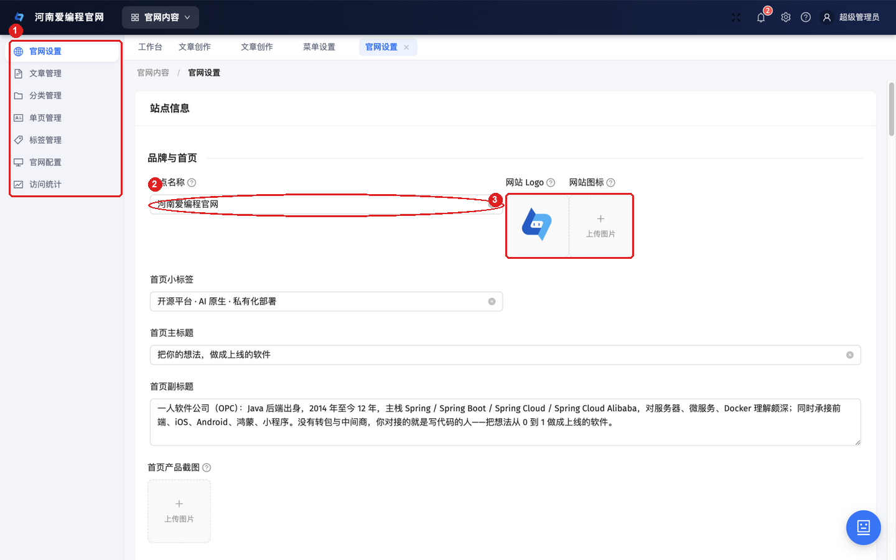

### 2.2 首页首屏（Hero 区）

| # | 后台字段 | 官网哪里显示 | 留空时 |
| --- | --- | --- | --- |
| 1 | **首页小标签** | 首页首屏顶部小胶囊（渐变发光字） | 显示「企业级业务管理平台」 |
| 2 | **首页主标题** | 首页正中大标题（H1，渐变色） | 显示站点名称 |
| 3 | **首页副标题** | 主标题下方一段介绍（逐字浮现动画） | 显示站点描述 → 再退内置文案 |
| 4 | **首页产品截图** | 副标题下方的浏览器拟真大图 | 用内置后台截图 |
| — | 「看看案例 / 聊聊你的想法」按钮 | 首屏按钮 | 代码内置，后台不可配 |

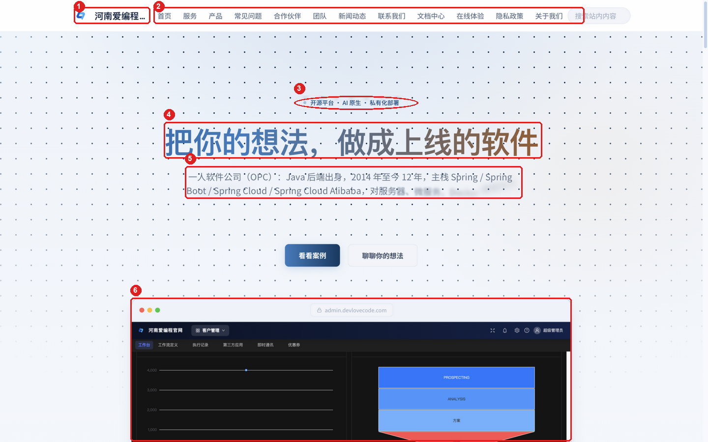

> ② 顶部导航 = 固定栏目（首页/服务/产品/常见问题/合作伙伴/团队/新闻动态/联系我们）+ **单页管理里的页面**（如 文档中心、在线体验、隐私政策、关于我们）。单页建好后自动出现在导航，无需其他配置。

### 2.3 首页数字带与「选行简的五个理由」优势区

| # | 后台字段 | 官网哪里显示 | 留空时 |
| --- | --- | --- | --- |
| 1 | **首页数字带**（数字+说明，可加多行） | 首屏产品截图下方一排渐变大数字（如 13+ 业务模块），最多 4 列 | 整块隐藏 |
| 2 | **优势区块徽章** | 优势区顶部小胶囊（当前「选型决策框架」） | 显示「核心优势」 |
| 3 | **优势区块标题** | 优势区 H2 大标题（当前「选行简的五个理由」） | 显示「为什么选择我们」 |
| 4 | **优势区块副标题** | 标题下一行说明 | 隐藏该行 |
| 5 | **首页核心优势**（图标+标题+描述，可加多行） | 下方卡片墙：第 1 条横跨两列大卡，其余小卡；图标在下拉里选（ layers/monitor/星星…） | 整块隐藏 |

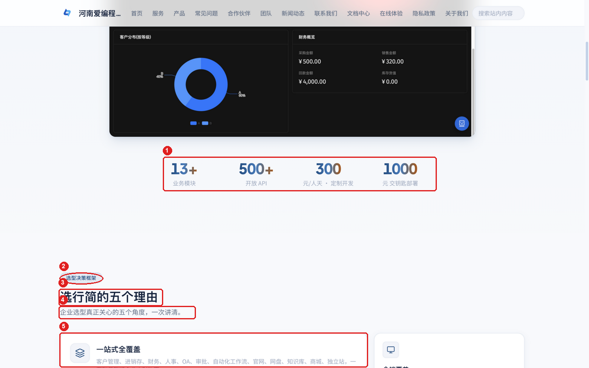

### 2.4 首页客户评价

| # | 后台字段 | 官网哪里显示 | 留空时 |
| --- | --- | --- | --- |
| 1 | **首页客户评价**（评价内容/姓名/职位/公司） | 首页「他们这样说」区的大引号卡片；姓名加粗、职位与公司灰色小字 | 评价内容和姓名**必须都填**，缺一个整块隐藏 |

### 2.5 底部号召与页脚

| # | 后台字段 | 官网哪里显示 | 留空时 |
| --- | --- | --- | --- |
| 1 | **底部号召标题** | 首页最底部深色区大标题（当前「有个想法?」） | 显示「联系我们，开启合作」 |
| 2 | **号召标题高亮词** | 标题右侧渐变橙色词（当前「先聊聊就对了」） | 无高亮词 |
| 3 | **底部号召副标题** | 标题下说明行 | 显示内置引导文案 |
| — | 「联系我们 / 先看看产品」按钮 | 号召区按钮 | 代码内置 |
| 4 | **联系电话 / 联系邮箱 / 联系地址 / 工作时间** | 每页**页脚**「联系方式」列 4 行（页码见下图⑥）；同时进搜索引擎结构化数据 | 全空时显示固定兜底两行 |
| 5 | **官网备案号** | 页脚最底行（点击跳工信部备案网） | 不显示 |
| 6 | **公安备案号 + 公安备案链接** | 页脚最底行（链接不填跳公安部官网） | 号不填不显示 |
| 7 | **版权信息** | 页脚版权行 | `© 年份 站点名. All rights reserved.` |

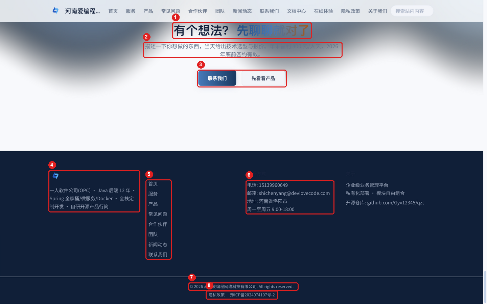

> 页脚左侧简介列（「一人软件公司(OPC) · Java 后端 12 年…」）是**代码内置文案**，后台不可改。

### 2.6 SEO 与统计（游客看不见，搜索引擎看得见）

| # | 后台字段 | 官网哪里显示 |
| --- | --- | --- |
| 1 | **站点描述** | 每页 `<meta description>` 与分享卡片摘要（百度/谷歌结果页的描述文字）；也是首页副标题的兜底文案 |
| 2 | **搜索关键词** | `<meta keywords>` |
| 3 | **SEO 地域码 / SEO 所在地名 / SEO 经纬度** | `geo.region` / `geo.placename` / `geo.position` 元信息 + 结构化数据里的公司地址坐标（本地搜索友好） |
| 4 | **统计代码** | 每页注入的第三方统计 `<script>`（百度统计/Google Analytics 等，粘贴其给出的代码即可） |

### 2.7 常见问题（FAQ）与 AI 接入地址

| # | 后台字段 | 官网哪里显示 | 留空时 |
| --- | --- | --- | --- |
| 1 | **官网常见问题**（问题+答案） | ① `/faq` 页手风琴列表（问=条目标题，答=展开内容）② 页面源码里的 FAQPage 结构化数据（AI 搜索引擎引用的主要来源）③ `/md/faq` 与 llms-full.txt | 显示「暂未配置常见问题」 |
| 2 | **AI 工具接入地址** | ⚠️ 官网页面当前**没有**消费此字段（首页 AI 区文案为内置），仅作为后台留档 | — |

> FAQ 写法建议：问答里带具体数字/价格（费用、周期、部署方式），更容易被 AI 搜索引擎直接引用。

---

## 三、官网配置（`/cms/homepage-config`）——首页三个板块

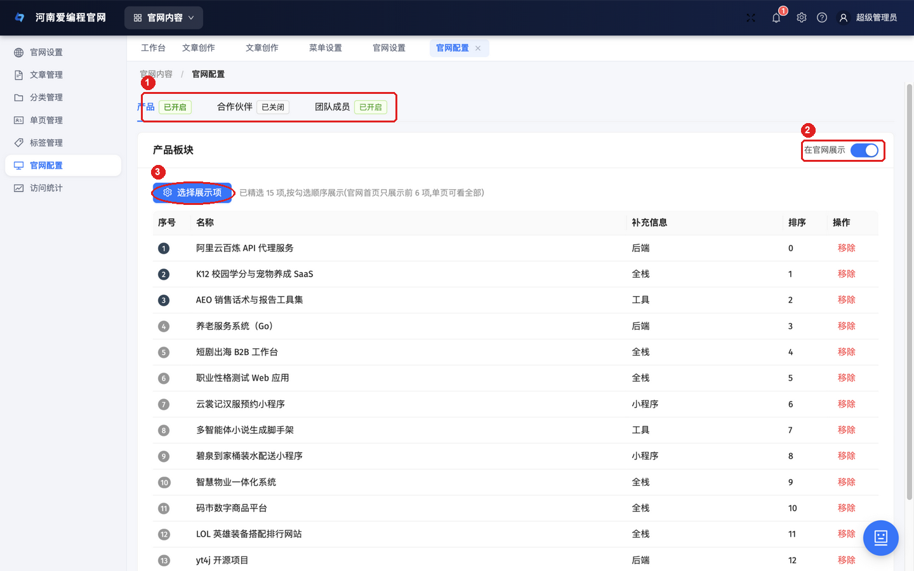

| # | 后台元素 | 官网哪里显示 | 规则 |
| --- | --- | --- | --- |
| 1 | **板块页签 + 「在官网展示」开关**（产品/合作伙伴/团队成员） | 首页对应板块整体显示/隐藏 | 关掉即首页不出现该板块 |
| 2 | **选择展示项**（勾选条目） | 首页「产品精选 / 合作伙伴 / 团队」卡片墙 | **产品板块官网最多展示前 6 项**；合作伙伴、团队成员不截断 |
| 3 | **排序**（数字） | 决定官网卡片排列顺序（按后台排序返回） | 官网按接口顺序展示 |
| 4 | **条目字段**：名称 / 图片 / 描述 / 补充信息 | 产品卡=图片+名称+描述+分类角标；合作伙伴=首字方块+名称+「行业 · 级别」副行；团队=圆头像+昵称+职位 | 图片缺失用首字方块/内置头像兜底 |
| 5 | 各板块的「查看全部 →」 | 跳 `/products`、`/partners`、`/team` | 板块标题文案内置 |

> 注意：首页「团队成员」板块显示的是这里**精选勾选**的成员；而 `/team` 页显示的是系统里**全部**成员（上限 48 人），两者不是一个数据源。

---

## 四、文章管理（`/cms/article`）——官网「新闻动态」

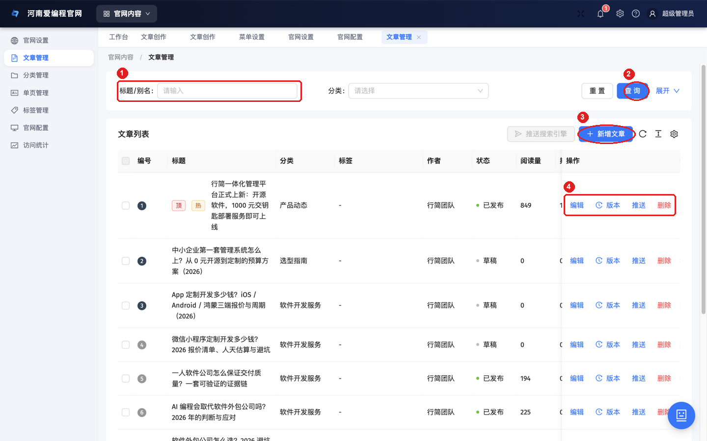

| # | 后台字段 | 官网哪里显示 | 说明 |
| --- | --- | --- | --- |
| 1 | **标题** | `/news` 列表卡片标题、`/news/[slug]` 详情页 H1、浏览器标签标题 | |
| 2 | **分类**（必填） | 列表卡片左上分类胶囊、详情页分类胶囊（可点击回该分类列表） | 分类由「分类管理」维护 |
| 3 | **标签** | ⚠️ 官网页面当前**不显示**标签（详情/列表均无），仅后台归类用 | 如实说明 |
| 4 | **封面** | 详情页标题下方大图；列表卡片**不显示**封面 | 不传则详情无图 |
| 5 | **摘要** | 列表卡片两行摘要、详情页标题下摘要、分享卡片描述 | |
| 6 | **内容**（Markdown） | 详情页正文（支持表格/代码块/图片）；同步进 `/md/news/*` 与 llms-full.txt（AI 引擎可见） | |
| 7 | **状态**（草稿/已发布） | 草稿官网不可见；已发布才会出现在 `/news` | 定时未到点同草稿 |
| 8 | **定时发布时间** | 到点前官网不可见，到点自动可见并推送搜索引擎 | 后端自动处理 |
| 9 | **置顶 / 热门** | 官网卡片**不显示**「顶/热」徽章，仅影响公开接口的排序 | 后台列表里的徽章只在后台可见 |
| 10 | **排序 / 有效期至** | 排序影响列表顺序；过期文章官网不再可见 | |
| 11 | 行操作「版本」 | 不直接上官网；用于回滚历史版本 | |
| 12 | 「推送搜索引擎」/行内「推送」 | 把文章 URL 提交给百度收录（官网 `/sitemap.xml` 也会自动带出全部文章） | |

详情页另有：**阅读量**（浏览次数，自动统计）、作者（不显示在页面，进文章结构化数据，默认「行简软件」）。无上一篇/下一篇导航。

---

## 五、分类管理 / 标签管理

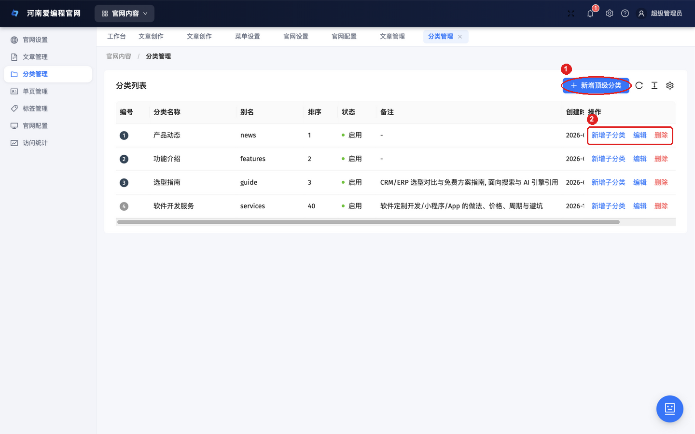

- **分类管理**：文章分类的增删改（支持子分类）。分类名 → 官网 `/news` 卡片胶囊与详情胶囊。
- **标签管理**：⚠️ 官网暂无消费点（不显示在任何页面），现阶段仅后台管理用，可简化维护。

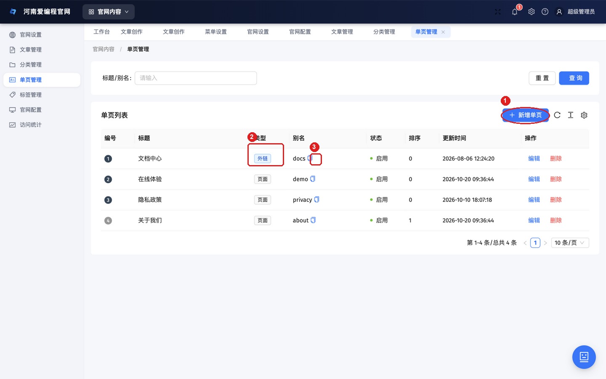

## 六、单页管理（`/cms/page`）——导航上的自由页面

| # | 后台字段/类型 | 官网哪里显示 |
| --- | --- | --- |
| 1 | 类型=**页面** | 顶部导航出现该页名称 → 点击进 `/p/别名`（标题作页首大标题，内容按 Markdown 渲染） |
| 2 | 类型=**外链** | 顶部导航出现该页名称 → 点击**新窗口**打开填的外部网址（如「文档中心 docs」） |
| 3 | 别名 | 页面型决定 URL（`/p/别名`）；别名列的复制按钮可复制访问路径 |
| 4 | 特殊别名 `about` | 被 `/about`「关于我们」页专用（内容即单页 about 的 Markdown） |
| 5 | 特殊别名 `privacy` | 「隐私政策」页，被官网联系表单底部的隐私告知链接引用（删掉它表单处链接会失效） |

## 七、访问统计（`/cms/track`）

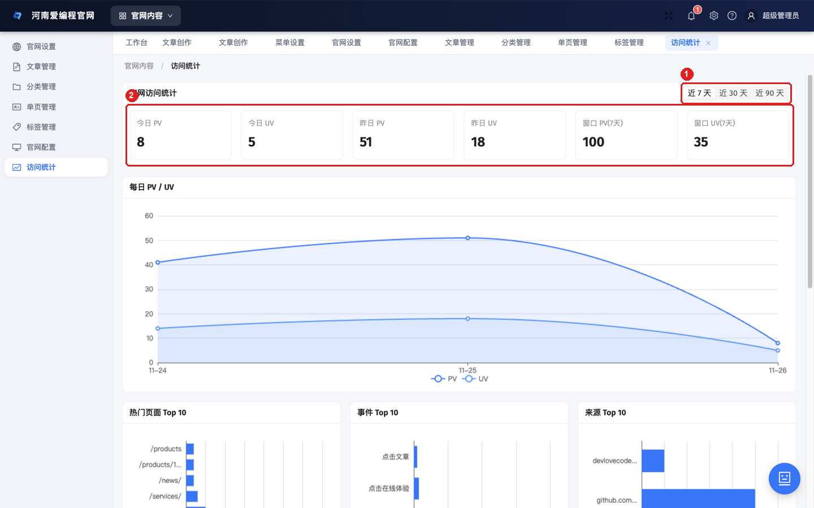

纯数据看板，不对应官网元素：今日/昨日/窗口 PV·UV 指标卡、每日曲线、热门页面 Top10、事件 Top10（点击文章、点击在线体验等，来自官网埋点）、来源 Top10。

## 八、官网「产品」页 = CRM 产品管理

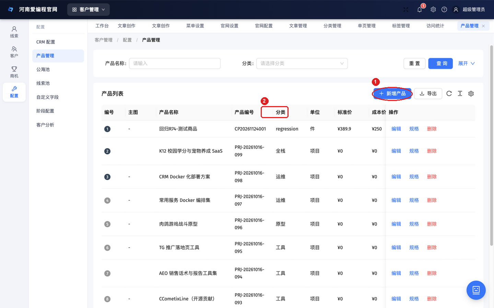

路径：**客户管理 → 配置 → 产品管理**（产品分类树在同级的分类维护里，仅叶子可选）。

| # | CRM 字段 | 官网哪里显示 |
| --- | --- | --- |
| 1 | **产品名称** | `/products` 卡片标题、详情页 H1 |
| 2 | **主图** | 列表卡片图（缺省渐变占位块）、详情页大图 |
| 3 | **分类** | 列表页两级筛选（一级 Tab + 子分类胶囊，带数量角标）、卡片与详情的分类胶囊 |
| 4 | **产品介绍/描述** | 卡片两行纯文本摘要、详情页「产品介绍」正文（Markdown） |
| 5 | **产品编号** | 详情页「编号：xxx」；列表卡片为空显示 — |
| 6 | **标准价**（+单位） | 卡片与详情的 `¥价格`，**仅价格 > 0 才显示**；单位不填显示「件」 |
| 7 | 首页精选 | 另在「官网配置」勾选后进首页产品板块（≤6 条） |

> 价格说明：中文官网只显示 CRM 里的 CNY 标准价；USD 折算仅存在于跨境独立站（storefront）。

## 九、联系表单的线索去向

官网 `/contact`（页脚「联系我们」）：姓名\*、电话\*、邮箱、公司、留言\* → 提交后自动创建 **CRM 线索（入公海池）**，并按通知规则推送管理员（企微/站内信）；表单带防机器人蜜罐字段。表单字段结构内置，不可在后台增删。

## 十、官网内置、后台改不了的区块

- 「服务」页组（`/services`）全部文案与报价卡
- 首页「年末定价」三张卡（300 元/人天等）
- 首屏「看看案例 / 聊聊你的想法」、号召区按钮
- 页脚左侧简介列文案
- `/team` 页头、各板块「查看全部」等固定文案

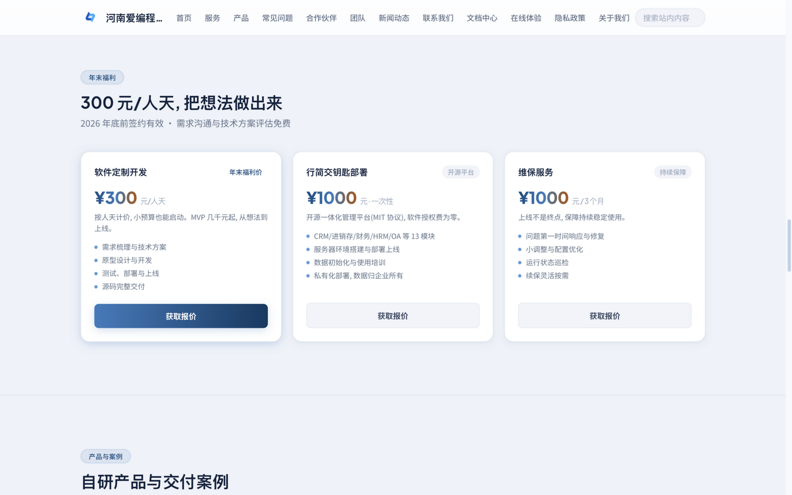

## 十一、发布与常见问题

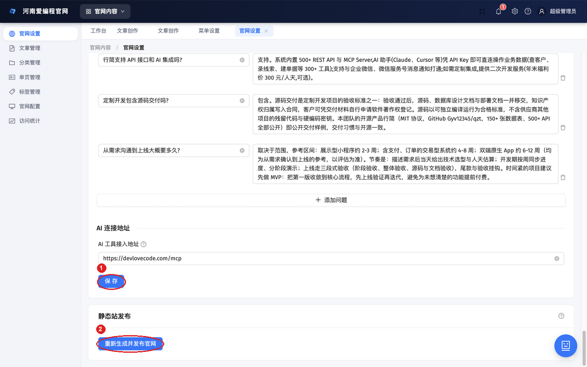

- **发布**：官网设置页底部「重新生成并发布官网」（仅超管可见），服务器后台异步构建（官网+独立站一起更新），进行中重复点击会被拒绝；失败看 `/opt/qzt-server/logs/rebuild_*.log`。
- **演示模式差异**：公开演示站冻结「官网设置保存」与「官网配置启停/同步」（有意设计，防演示访客改乱官网），文章/分类/标签/单页不受限；正式私有化部署无任何限制。

| 现象 | 原因与处理 |
| --- | --- |
| 后台改了官网没变化 | 没点「静态站发布」；或发布还在构建中 |
| 数字带/优势/评价整块消失 | 对应 JSON 内容留空或格式非法（评价缺姓名、数字带解析失败都会整块隐藏） |
| 文章发了官网看不到 | 状态非「已发布」；定时未到点；改完没发布 |
| 标签/置顶/热门官网看不到 | 设计如此：官网不渲染这些元素（见第四章表格） |
| 点导航出现一个意外页面 | 单页管理里建了页面型单页，建好即自动上导航 |
| 留言线索在哪 | CRM 线索公海池，标题带来源 |
